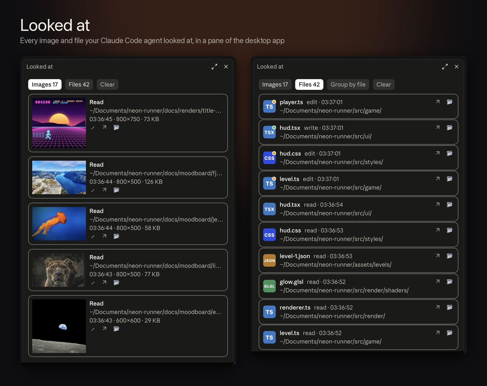
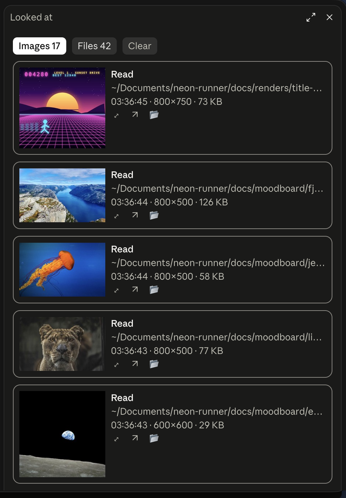
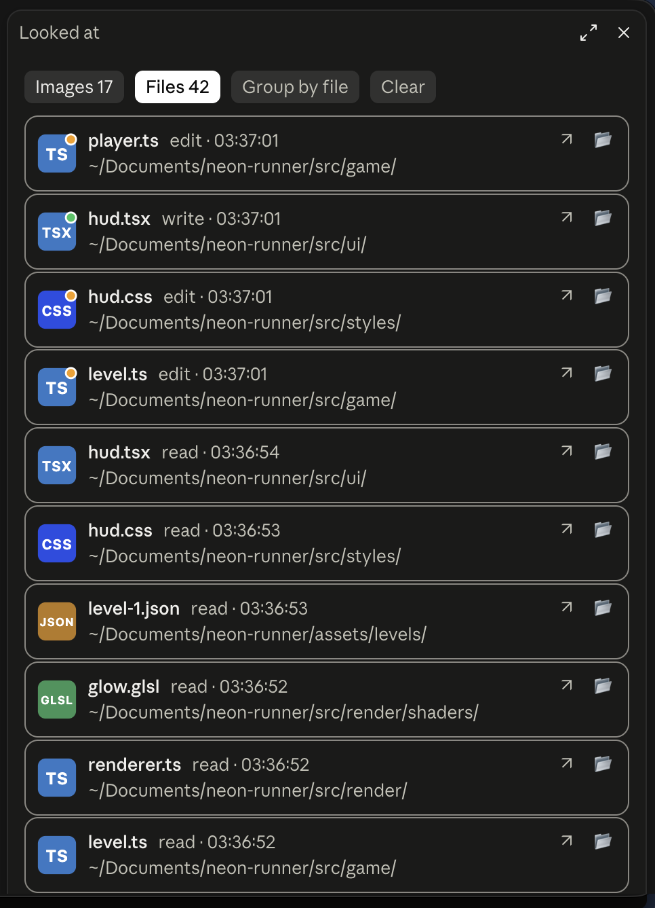
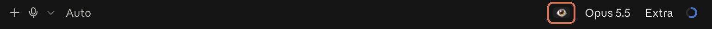

# Looked at

**See what your Claude Code agent saw.** Agents working through CLIs and MCP servers take screenshots, render scenes and read images you never get to see. Looked at collects every one of them, plus every file the agent read or changed, in a pane of the Claude desktop app.



## What you get

- **Images tab:** every image a tool handed the agent, newest first. That covers browser and simulator screenshots, renders, image files it read, and the ones its subagents saw. Each row shows a thumbnail, the tool, its input (path, action or URL), the time, the pixel size and the file size.
- **Viewer:** ⤢ opens an image large in a pane of its own. ‹ and › step through the history, and Esc or ✕ closes it.
- **Files tab:** every Read, Edit and Write, with a file-type icon, line ranges and times. An orange dot on the icon marks an edit and a green dot a write. **Group by file** folds repeats into one row per file.
- **Buttons:** ↗ opens a file or image in its default app, and 📂 shows it in Finder or Explorer. Hover over a path to see it in full.
- **👁 in the footer**, next to the model picker, opens and closes the pane.

<p align="center">
  
  
</p>

<p align="center">
  <br>
  <sub>The 👁 next to the model picker opens and closes the pane.</sub>
</p>

## It only watches

Looked at is a view built from the session's own output. It reads the rows the session stores and passes every one on unchanged. It adds no tools, no slash commands and nothing to the prompt or the context, so the agent never knows it's there.

To make thumbnails, it copies images to your temp folder: `$TMPDIR/claude-looked-at/<session>` on macOS and `%TEMP%\claude-looked-at\<session>` on Windows. Nothing leaves your machine.

## Install

In Claude Code in a terminal, run:

```
/plugin install looked-at --marketplace ozdeger/claude-looked-at-mod
```

Answer `y` to add the marketplace, then choose the user scope. Code tab sessions you start in the Claude desktop app after that load the mod. Click 👁 under the prompt to open the pane.

### Requirements

- **Claude Code:** built and tested on 2.1.293. Mods (plugins made of function hooks) are early access, and their API can change between releases.
- **The Claude desktop app:** the pane and the 👁 are drawn only there.
- **macOS or Windows:** macOS makes thumbnails with the built-in `sips`; Windows uses PowerShell and .NET's System.Drawing. Windows support is new and hasn't been run on a Windows machine yet, so issues are welcome.

## Develop

```bash
claude plugin validate .
claude plugin test .
claude --plugin-dir .
```

- `hooks/register.tsx` is the hooks module: it captures rows and draws the pane, the viewer and the 👁.
- `hooks/capture.ts` turns stored rows into image and file entries.
- `hooks/platform.ts` holds the macOS and Windows commands.
- `hooks/icons.ts` draws the file-type icons.

## Credits

The demo images in the screenshots are photos from [Unsplash](https://unsplash.com), served by [Lorem Picsum](https://picsum.photos) under the Unsplash License, and *Earthrise* by NASA/Bill Anders, which is public domain. The neon game frame comes from a small demo project made for these screenshots.

## License

[MIT](LICENSE)
